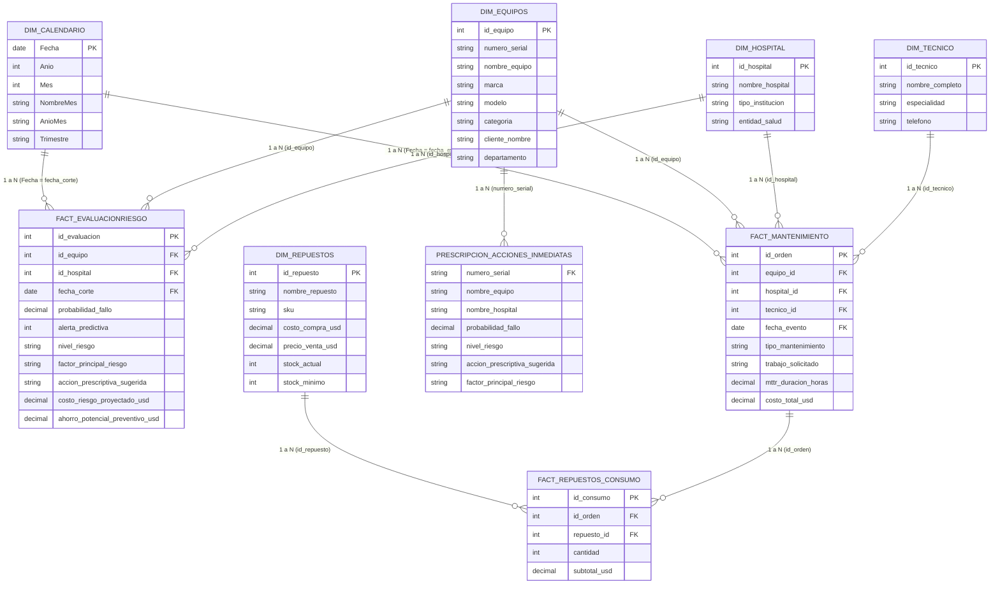

# **UNIVERSIDAD NACIONAL DE INGENIERÍA**

## **INFORME TÉCNICO Y ESTRATÉGICO DE ANALÍTICA PREDICTIVA, DIAGNÓSTICO CAUSAL Y OPTIMIZACIÓN PRESCRIPTIVA DEL PARQUE BIOMÉDICO DE IMPORTMED S.A.**

**Autores:**  
Ángel Daniel Escobar Báez (Carnet: 2022-0752I)  
Brayan Brandon Mairena Fonseca (Carnet: 2022-0749I)  
Jimmy Antonio Palacios Báez (Carnet: 2022-0734I)

**Docente:**  
Ing. Roberto Alfaro Arriola

Managua, Nicaragua  
Octubre de 2026

---

## **Resumen Ejecutivo**

El presente informe técnico expone la arquitectura analítica, validación empírica y aplicación de inteligencia de negocios desarrollada sobre el parque biomédico de IMPORTMED S.A. a través de Microsoft Power BI Desktop. Se estructuró un modelo en estrella compuesto por 9 entidades relacionales orientado a cuatro niveles de madurez analítica: descriptiva, diagnóstica, predictiva y prescriptiva. Los resultados revelan una flota nacional de 229 activos biomédicos con una tasa de falla global histórica del 57.0%, originada por una asimetría presupuestaria donde el 92.4% del gasto (\$214,000 USD de \$229,310 USD totales) se ha destinado a mantenimiento correctivo de emergencia. Mediante el análisis SHAP y la curva de degradación MTTR, se demostró que el punto crítico de colapso no ocurre a los 180 días estipulados por los fabricantes, sino entre los días 70 y 125, acentuado por inestabilidad transitoria post-reparación. La consola prescriptiva prioriza 41 órdenes urgentes concentradas en un 63.4% en 4 centros hospitalarios, ofreciendo un ahorro preventivo directo de \$15,090 USD y mitigando un costo de riesgo proyectado de \$415,580 USD (factor de protección de 27.54x). Finalmente, el análisis de inventario Kardex en líneas identifica convergencia crítica en módulos electrónicos y ópticos esenciales.

*Palabras clave:* Confiabilidad biomédica, Power BI, Mantenimiento predictivo, Analítica prescriptiva, Curva de degradación, Análisis SHAP, Kardex de repuestos.

---

## **1\. Introducción y Marco Metodológico**

El mantenimiento de equipamiento médico y de laboratorio clínico representa un eje neurálgico en la gestión de servicios de salud. IMPORTMED S.A., empresa distribuidora y prestadora de servicios de soporte técnico biomédico en Nicaragua, enfrenta desafíos operativos asociados a la gestión de 229 analizadores hematológicos, analizadores bioquímicos, centrífugas clínicas y autoclaves distribuidos a nivel nacional. La transición desde un modelo puramente reactivo hacia un esquema predictivo y prescriptivo demandó la ingesta, modelado y visualización de datos en Microsoft Power BI Desktop bajo un esquema dimensional en estrella (Star Schema).

La sección **1.1 Arquitectura del Modelo Dimensional en Estrella (*Star Schema*)** queda completa al incorporar la novena entidad, **`Prescripcion_Acciones_Inmediatas`**, tanto en la tabla del informe en formato APA 7 como en el diagrama `mermaid`:

#### **1.1 Arquitectura del Modelo Dimensional en Estrella (*Star Schema*)**

Para garantizar el máximo rendimiento del motor columnar en memoria **VertiPaq** de Microsoft Power BI y evitar problemas de ambigüedad en las rutas de filtrado o relaciones de muchos a muchos ($N:M$), se diseñó una arquitectura dimensional en estrella (*Star Schema*) compuesta por **9 entidades**: cinco tablas dimensionales (`Dim_`), tres tablas de hechos transaccionales (`Fact_`) y una tabla especializada de salida prescriptiva (`Prescripcion_Acciones_Inmediatas`) que consolida el plan de acción mandatorio para los activos que requieren intervención inmediata. Todas las relaciones se configuraron bajo una cardinalidad estricta de **uno a varios ($1:\infty$)** y **dirección de filtro cruzado única**, asegurando que las dimensiones filtren de manera descendente a las tablas operativas y prescriptivas sin penalizar el tiempo de cómputo de las medidas DAX.

**Tabla 1**

*Diccionario de las 9 Entidades, Llaves y Relaciones del Modelo Dimensional en Power BI*

| Entidad del Modelo | Rol en el Esquema | Llave Primaria (PK) | Llaves Foráneas (FK) / Relaciones ($1:\infty$) | Atributos Principales de Análisis |
| --- | --- | --- | --- | --- |
| **`Dim_Calendario`** | Dimensión Temporal (Tabla de Fechas)

 | `Fecha`  | Filtra a `Fact_EvaluacionRiesgo[fecha_corte]` y `Fact_Mantenimiento[fecha_evento]`  | `Anio`, `Mes`, `NombreMes`, `AnioMes`, `Trimestre`  |
| **`Dim_Equipos`** | Dimensión de Activos Biomédicos

 | `id_equipo`  | Filtra a `Fact_EvaluacionRiesgo[id_equipo]`, `Fact_Mantenimiento[equipo_id]` y `Prescripcion_Acciones_Inmediatas`  | `numero_serial`, `nombre_equipo`, `marca`, `modelo`, `categoria`, `departamento`  |
| **`Dim_Hospital`** | Dimensión Institucional / Clientes

 | `id_hospital`  | Filtra a `Fact_EvaluacionRiesgo[id_hospital]` y `Fact_Mantenimiento[hospital_id]`  | `nombre_hospital`, `tipo_institucion`, `entidad_salud` |
| **`Dim_Tecnico`** | Dimensión de Personal de Soporte

 | `id_tecnico`  | Filtra a `Fact_Mantenimiento[tecnico_id]`  | `nombre_completo`, `especialidad`, `telefono` |
| **`Dim_Repuestos`** | Dimensión de Catálogo e Inventario (Kardex)

 | `id_repuesto`  | Filtra a `Fact_Repuestos_Consumo[repuesto_id]`  | `sku`, `nombre_repuesto`, `costo_compra_usd`, `stock_actual`, `stock_minimo`  |
| **`Fact_EvaluacionRiesgo`** | Tabla de Hechos Predictivos y SHAP

 | `id_evaluacion` | `id_equipo`, `id_hospital`, `fecha_corte`  | `probabilidad_fallo`, `alerta_predictiva`, `nivel_riesgo`, `factor_principal_riesgo`, `ahorro_potencial_preventivo_usd`  |
| **`Fact_Mantenimiento`** | Tabla de Hechos Operativos e Historial

 | `id_orden`  | `equipo_id`, `hospital_id`, `tecnico_id`, `fecha_evento` (y filtra $1:\infty$ a `Fact_Repuestos_Consumo`)

 | `tipo_mantenimiento`, `trabajo_solicitado`, `mttr_duracion_horas`, `costo_total_usd`  |
| **`Fact_Repuestos_Consumo`** | Tabla de Hechos de Consumo de Piezas

 | `id_consumo` | `id_orden`, `repuesto_id`  | `cantidad`, `subtotal_usd` |
| **`Prescripcion_Acciones_Inmediatas`** | Tabla de Hechos / Salida Prescriptiva (Consola Página 3)

 | `numero_serial` / `id_prescripcion`  | Vinculada a `Dim_Equipos[numero_serial]` y `Dim_Hospital[nombre_hospital]`  | `numero_serial`, `nombre_equipo`, `nombre_hospital`, `probabilidad_fallo`, `nivel_riesgo`, `accion_prescriptiva_sugerida`, `factor_principal_riesgo`  |

### 2. Diagrama

## **2\. Evolución del Modelo Analítico y Validación de Integridad de Datos**

Durante la construcción del tablero, se identificó que las métricas troncales \[Equipos Riesgo Alto\], \[Ahorro Potencial Preventivo USD\] y \[Alertas Preventivas Activas\] arrojaban valores nulos debido a la discrepancia entre la dimensión calendario (extendida hasta diciembre de 2026\) y el último corte registrado en la tabla Fact\_EvaluacionRiesgo.

La corrección en DAX mediante la evaluación dinámica del último corte real disponible:

`VAR UltimoCorte = CALCULATE(MAX(Fact_EvaluacionRiesgo[fecha_corte]), ALL(Fact_EvaluacionRiesgo))`permitió desbloquear la cuantificación exacta del estado del parque: 41 equipos en riesgo alto (17.90% de la flota), 96 alertas preventivas activas y \$15,090 USD de ahorro preventivo directo. Asimismo, se corrigieron distorsiones de agregación en la tabla de evaluación de riesgo, sustituyendo la suma de probabilidades por el promedio ponderado, lo que situó la probabilidad media global de fallo en 24.0% con un promedio de 82.88 días transcurridos desde el último preventivo.

## **3\. Análisis de la Página 1: Torre de Control Ejecutiva y Semáforo Hospitalario**

La Torre de Control ofrece la visión macroeconómica y espacial de la flota:

* **Dimensión del Parque:** 229 equipos biomédicos.  
* **Tasa de Falla Global:** 57.0% (0.57), confirmando que las órdenes de rotura superan a las rutinas de preservación.  
* **Asimetría Financiera:** De los \$229,310 USD gastados históricamente, el 92.4% (\$214,000 USD) corresponde a mantenimiento correctivo y sólo el 7.6% a mantenimiento preventivo. La especialidad de Hematología absorbe cerca de \$120,000 USD en correctivos frente a \$8,000 USD en preventivos (relación de 15 a 1).  
* **Distribución Territorial:** Managua concentra aproximadamente 77 equipos y cerca de \$4,800 USD en potencial de ahorro, seguida por Chinandega (28 equipos), León (27 equipos) y Matagalpa (25 equipos).  
* **Dinámica Cíclica Temporal (2023-2026):** Se evidencia un ciclo vicioso con desfase trimestral. Tras valles de prevención (2-3 servicios mensuales), emergen picos correctivos de hasta 23 averías mensuales que obligan al taller a desplegar operativos de choque reactivos, desatendiendo nuevamente el calendario preventivo.

## **4\. Análisis de la Página 2: Diagnóstico Causal y Degradación de Activos (SHAP)**

La vista diagnóstica profundiza en los factores causales de falla y la cinemática del deterioro técnico:

* **Factores Determinantes SHAP:** Si bien el Desgaste Operativo Normal agrupa el mayor volumen histórico (más de 3,100 registros), la Inestabilidad Transitoria Post-Reparación se consolida como la primera anomalía crítica con aproximadamente 220 registros, revelando fallas secundarias o descalibraciones ópticas tras reparaciones en taller.  
* **Curva de Degradación y Ventana Crítica:** El gráfico de dispersión demuestra que el domo de mayor acumulación de costos (\$2,500 a \$4,800 USD) se concentra entre los días 70 y 125 posteriores al último preventivo, muy por debajo de los 180 días normativos recomendados por el fabricante.  
* **Auditoría Forense y MTTR:** El parque registra 61,635 horas acumuladas de parada técnica (MTTR promedio de 269 horas por activo). Fallas en consumibles de bajo costo, tales como lámparas halógenas de \$143 USD, empaques de silicona de \$130 USD o jeringas dosificadoras de \$202 USD, provocaron paradas de entre 72 y 96 horas debido a la falta de reemplazo preventivo oportuno.

| Componente Crítico | Costo Unitario (USD) | Tiempo de Parada Asociado | Impacto en Operabilidad |
| :---- | :---- | :---- | :---- |
| Lámpara Halógena | \$143 USD | 72 \- 96 horas | Suspensión de pruebas fotométricas |
| Empaque de Silicona | \$130 USD | 48 \- 72 horas | Pérdida de estanqueidad en autoclave |
| Jeringa Dosificadora | \$202 USD | 72 \- 96 horas | Error de aspiración en hematología |

## **5\. Análisis de la Página 3: Consola Prescriptiva, Rutas Técnicas y Kardex en Líneas**

La capa prescriptiva convierte los hallazgos analíticos en decisiones operativas ejecutables:

* **Rentabilidad del Mantenimiento:** Frente a un costo de riesgo proyectado de \$415,580 USD en caso de falla catastrófica, la ejecución de las intervenciones preventivas capturará un ahorro directo de \$15,090 USD, generando un factor de protección de 27.54x.  
* **Optimizador de Rutas Técnicas:** Los 41 activos críticos se encuentran en 11 instituciones, pero 4 de ellas concentran el 63.41% de las urgencias: Hospital Militar Dr. Alejandro Dávila Bolaños (9 equipos), Hospital Fernando Vélez Paiz (7 equipos), Hospital Regional San Juan de Dios de Estelí (6 equipos) y Hospital Escuela César Amador Molina de Matagalpa (4 equipos). Esto permite organizar la atención en dos brigadas logísticas eficientes: Brigada Metropolitana (25 equipos) y Brigada Norte-Occidente (13 equipos).  
* **Monitoreo de Inventario Kardex en Líneas:** La comparativa de Stock Actual vs. Umbral Mínimo por SKU clasifica el inventario en tres zonas:  
  1. *Alta Holgura:* Mangueras peristálticas, filtros HEPA, lámparas halógenas y juntas de autoclave (+40 a \+65 unidades de colchón).  
  2. *Zona de Transición:* Sensores térmicos, jeringas micro-volumétricas y kits de prueba (+21 a \+35 unidades).  
  3. *Zona de Convergencia Crítica:* Celdas de cuarzo (CELD-CUA-10), sensores ópticos (SENS-OPT-04), motores de centrífuga (MOT-BRU-06), fuentes de poder (POW-SUP-14) y tarjetas electrónicas (TARJ-MAIN-07). La disponibilidad de estos últimos se encuentra entre 12 y 22 unidades con un margen neto de apenas 9 a 18 unidades por encima del umbral mínimo, requiriendo reorden internacional inmediato por ser los repuestos asociados a los costos correctivos más elevados.

| Código SKU | Descripción del Repuesto | Stock Actual | Umbral Mínimo | Estado de Inventario |
| :---- | :---- | :---- | :---- | :---- |
| CELD-CUA-10 | Celda de Cuarzo de Alta Precisión | 12 | 3 | Convergencia Crítica |
| SENS-OPT-04 | Sensor Óptico de Lectura | 15 | 4 | Convergencia Crítica |
| MOT-BRU-06 | Motor Brushless para Centrífuga | 18 | 5 | Convergencia Crítica |
| POW-SUP-14 | Fuente de Poder Regulada | 20 | 6 | Convergencia Crítica |
| TARJ-MAIN-07 | Tarjeta Electrónica Principal | 22 | 4 | Convergencia Crítica |

## **6\. Conclusiones y Recomendaciones Estratégicas**

* **Reconfiguración del Ciclo Preventivo:** Reducir formalmente el intervalo preventivo de 180 a 90 días para analizadores hematológicos y centrífugas en régimen hospitalario intensivo.  
* **Protocolos Post-Reparación:** Implementar pruebas obligatorias de calibración óptica con TEST-001 y control de estabilidad eléctrica para mitigar la inestabilidad post-reparación.  
* **Protección Eléctrica Mandatoria:** Exigir sistemas UPS dedicados en analizadores de química y hematología para erradicar las fallas por fluctuaciones de red.  
* **Gestión de Adquisiciones:** Colocar órdenes de compra prioritarias para los 5 SKUs en convergencia crítica y movilizar cuadrillas bajo el esquema de rutas agrupadas.

